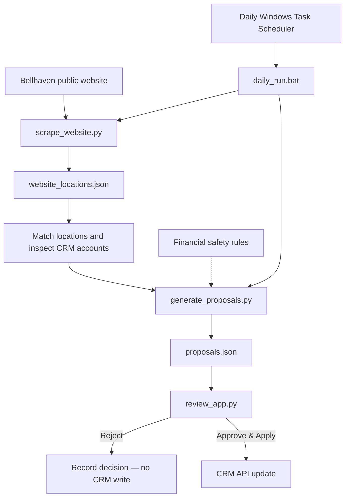
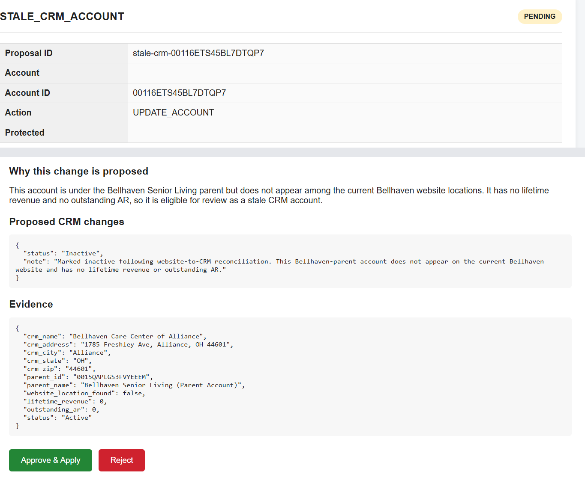
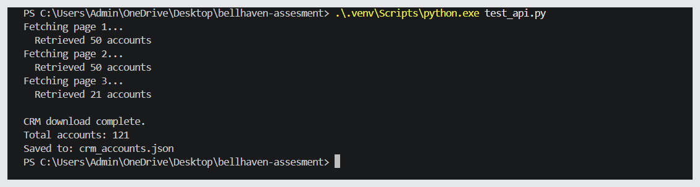

<div align="center">

# Bellhaven Senior Living  
## CRM Reconciliation & Review Workflow

**A Python automation project for matching website locations to CRM records, detecting discrepancies, and applying changes safely through human approval.**

[](https://www.python.org/)
[](#daily-automation)
[](#safety-by-design)
[](#results)

</div>

---

## At a glance

| 17 / 17 | 121 | 0 | 1 |
|:---:|:---:|:---:|:---:|
| Website locations confidently matched | CRM accounts reviewed | Unmatched website locations | Duplicate account resolved |

> **Core design principle:** automate discovery and recommendations, but require explicit human approval before a proposed change is written to the CRM.

## The problem

Website information and CRM records can drift apart. Community names may differ, parent-account relationships can be wrong, duplicate records can exist, and CRM accounts may remain after a location disappears from the public website.

Manually comparing every record is slow and error-prone. This project automates that comparison while preserving financial history and making proposed changes reviewable.

## How it works



1. **Collect:** scrape location names, addresses, cities, states, ZIP codes and care offerings from the website.
2. **Match:** compare website locations with CRM accounts using normalised names and location information, not exact name equality alone.
3. **Detect:** identify naming differences, parent-account issues, duplicate records and CRM accounts absent from the current website.
4. **Propose:** store each proposed action with a reason and supporting evidence.
5. **Review:** let a person approve or reject a proposal in the review application.
6. **Apply:** send an update to the CRM only after explicit approval.

## Screenshots

### Human review before a CRM change

The review interface displays the proposed action, its rationale, supporting CRM evidence and the **Approve & Apply** / **Reject** controls.



### CRM API pagination

The CRM API retrieval script fetches account records across multiple pages and saves the combined result for reconciliation.



## Safety by design

The workflow is deliberately more cautious than a script that simply edits records as soon as it finds a mismatch.

- **Human approval:** proposal generation does not directly write to the CRM. The review application applies an update only after explicit approval.
- **Financial safeguards:** accounts with both lifetime revenue and outstanding accounts receivable are protected from simple re-parenting. The specified change-of-ownership process preserves the historical account and links it to the new account.
- **Duplicate handling:** duplicate records are resolved through the designated duplicate reference and status/note fields rather than deleting records.
- **Repeatable runs:** existing decisions are preserved and already handled proposals are not continually recreated.
- **Fail-fast scheduling:** if website scraping fails, the batch workflow stops before proposal generation.

## Results

The final reconciliation run covered **121 CRM accounts** and **17 website locations**, with all 17 website locations confidently matched.

The reconciliation also surfaced naming differences and CRM-only accounts for review, and resolved a duplicate account. Financial-protection rules were checked against the CRM data, and the final CRM audit was run after changes were applied.

These figures describe the supplied assessment environment and its dataset; they are not claims about a live production deployment.

## Technology

- **Python** — scraping, matching, reconciliation, proposal generation and audit scripts
- **Requests / Beautiful Soup** — website and HTTP interactions
- **CRM REST API** — retrieving account data and applying approved updates
- **JSON** — structured location, matching and proposal outputs
- **HTML review application** — human review and approval workflow
- **Windows Batch + Task Scheduler** — daily automation
- **Git + GitHub** — version control and project publishing

## Project structure

| File | Purpose |
|---|---|
| `scrape_website.py` | Scrapes current Bellhaven website locations |
| `match_locations.py` | Matches website locations to CRM accounts |
| `reconcile.py` | Runs the reconciliation workflow and report generation |
| `generate_proposals.py` | Creates safe, evidence-backed change proposals |
| `review_app.py` | Presents proposals and applies explicitly approved updates |
| `audit_crm.py` | Audits the resulting CRM state and financial safeguards |
| `profile_crm.py` | Summarises CRM records and key data characteristics |
| `daily_run.bat` | Runs the scrape and proposal generation in sequence |
| `website_locations.json` | Captured website location data |
| `match_results.json` | Location matching results |
| `proposals.json` | Proposal records and review decisions |
| `reconciliation_report.json` | Reconciliation output |
| `crm_audit_summary.json` | CRM audit summary |
| `requirements.txt` | Python dependencies |

## Run locally

> This project was built for a supplied assessment API. To reproduce the workflow, you need valid assessment CRM API access and a local environment. Never commit a real API token.

1. Clone the repository and enter the project directory.
2. Create and activate a Python virtual environment.
3. Install dependencies:

   ```bash
   pip install -r requirements.txt
   ```

4. Create a local `.env` file with the API settings expected by the scripts. Keep `.env` out of version control.
5. Run the workflow:

   ```bash
   python scrape_website.py
   python generate_proposals.py
   ```

6. Start the review app using the launch instructions in `review_app.py` / the application configuration, then review proposals before applying any changes.

On Windows, the scheduled workflow can be run through `daily_run.bat`. Windows Task Scheduler is configured separately to launch the batch file daily.

## What I would build next

- A weighted match-confidence score using name, street, city, state and ZIP evidence.
- A more polished review dashboard with side-by-side website/CRM comparisons and clearer risk indicators.
- Automated tests for matching edge cases, API failures, duplicate handling and financially protected accounts.
- Monitoring and alerts for unexpected changes in website location counts.
- A stronger audit trail recording reviewer, timestamp, evidence and before/after values.

## What this project demonstrates

This project combines web scraping, API integration, data matching, discrepancy detection, safe workflow design, human review and scheduled automation. The focus is not only on finding data-quality issues, but on making proposed corrections **explainable, controlled and auditable**.
